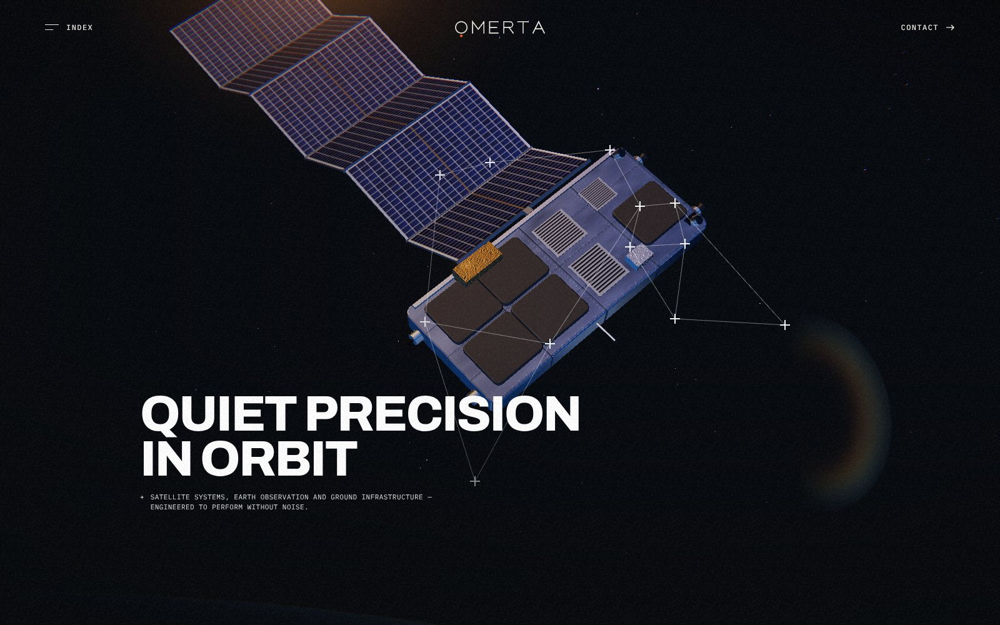
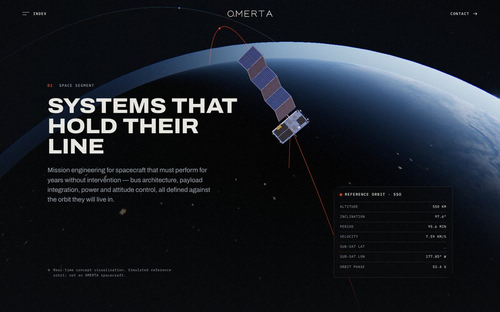
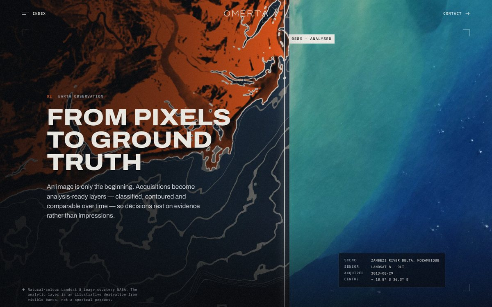
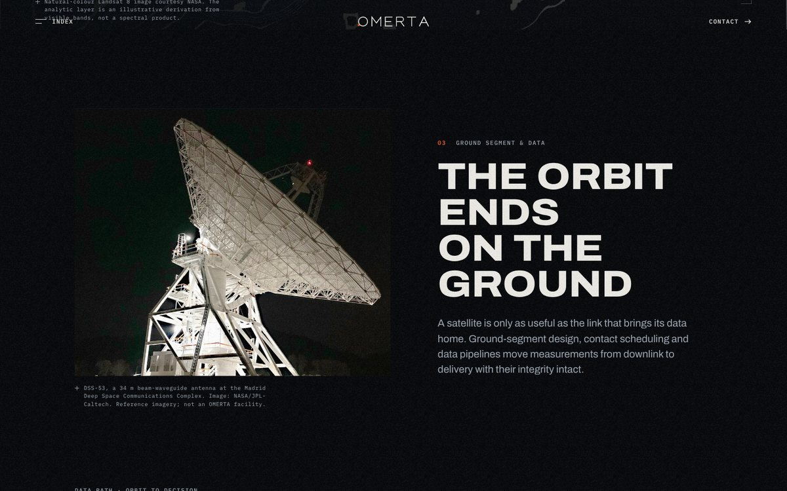
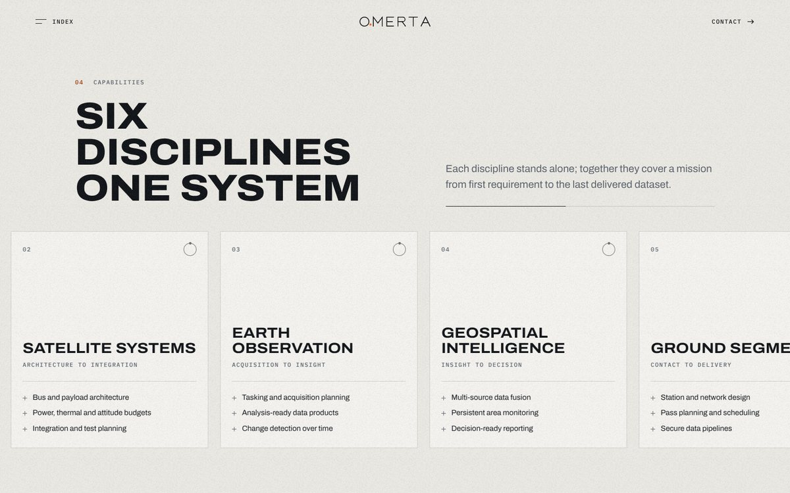
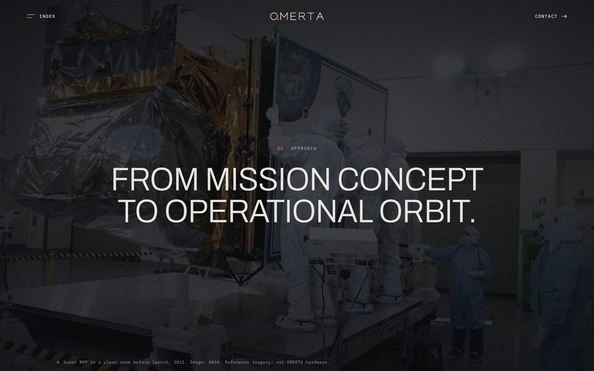
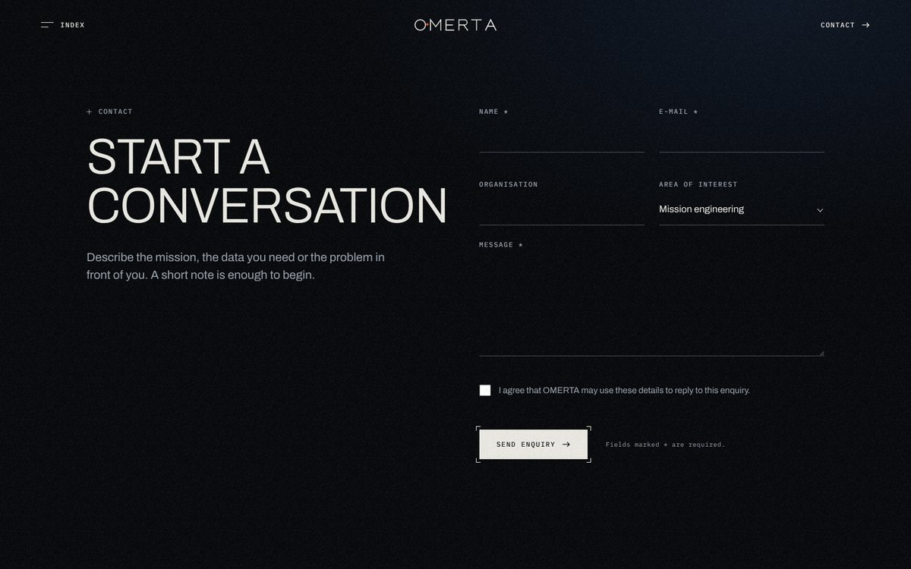
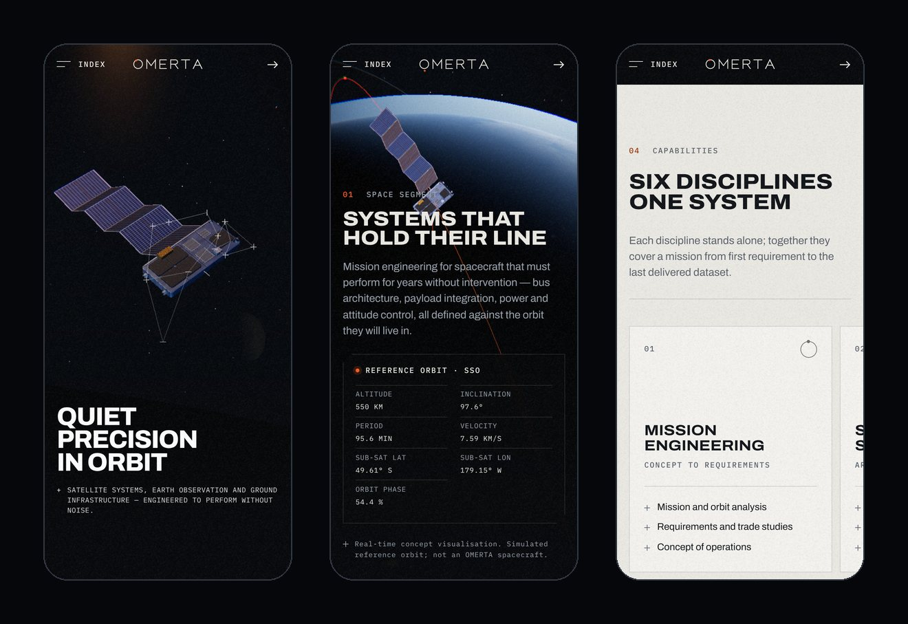
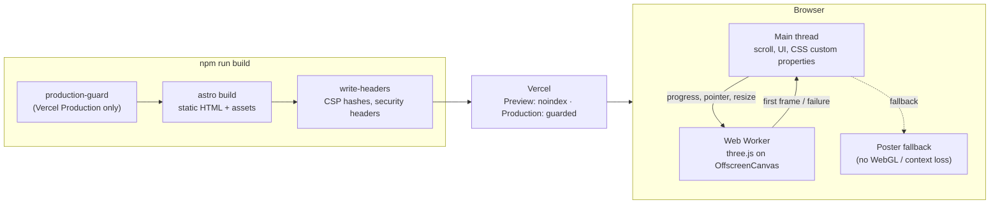

<p align="center">
  
</p>

<h1 align="center">OMERTA</h1>

<p align="center">
  <strong>Quiet precision, in orbit.</strong><br>
  The website of a satellite and space-technology brand: a real-time 3D orbit scene,<br>
  a chaptered scroll narrative, and a static build that holds up on every device.
</p>

<p align="center">
  <a href="https://omerta-space.vercel.app"><strong>Live preview →</strong></a>
  &nbsp;·&nbsp;
  <a href="docs/deployment.md">Deployment</a>
  &nbsp;·&nbsp;
  <a href="docs/final-qa-report.md">QA report</a>
  &nbsp;·&nbsp;
  <a href="docs/owner-inputs-and-release-blockers.md">Launch checklist</a>
</p>

<p align="center">
  <sub>Astro 7 · TypeScript · three.js · Web Workers · Lenis · Playwright · Vercel</sub>
</p>

> [!NOTE]
> **Pre-launch.** The link above is a Vercel **preview** and is excluded from search
> indexing. Service descriptions are provisional, and the production domain,
> contact endpoint and privacy notice are still to be supplied. Production builds
> are blocked by a release guard until they are.

---

## The experience

The page is one continuous descent, from a spacecraft in close-up to the ground
station that receives its data. Each chapter is a pinned stage driven by native
scroll.

<table>
  <tr>
    <td width="50%"></td>
    <td width="50%"></td>
  </tr>
  <tr>
    <td><strong>01 · Orbit.</strong> The camera pulls back from the hero to a 550 km sun-synchronous reference orbit. A HUD types out live sub-satellite coordinates computed in the browser.</td>
    <td><strong>02 · Observation.</strong> A scroll-driven scan line sweeps a Landsat 8 scene, turning natural colour into an analytic layer as you read.</td>
  </tr>
  <tr>
    <td></td>
    <td></td>
  </tr>
  <tr>
    <td><strong>03 · Ground.</strong> The data path from acquisition to delivery, revealed step by step along an orbit-to-decision timeline.</td>
    <td><strong>04 · Capabilities.</strong> Six disciplines on a pinned horizontal rail on desktop, and a native swipe with snap points on touch screens.</td>
  </tr>
  <tr>
    <td></td>
    <td></td>
  </tr>
  <tr>
    <td><strong>05 · Approach.</strong> Statements that focus in and out of blur over a full-bleed photograph, followed by a letterboxed finale.</td>
    <td><strong>Contact.</strong> Validated, accessible, and honest: it never reports success unless the form service confirms it.</td>
  </tr>
</table>

<p align="center">
  
</p>

---

## Under the hood

| | |
|---|---|
| **3D off the main thread** | The three.js scene renders in a Web Worker on an `OffscreenCanvas`, so scrolling and input stay responsive. Without worker support it falls back to the main thread after the first interaction. Without WebGL, on context loss, or if textures fail, a pre-rendered poster of the same scene stays in place. |
| **Built from code, not downloads** | The spacecraft is procedural geometry with canvas-drawn PBR maps (solar cells, anodised panels, MLI foil). The Earth uses NASA Blue and Black Marble in a day/night terminator shader, lit by image-based lighting, with bloom and a lens pass. |
| **Scroll without hijacking** | Stages read native scroll progress into CSS custom properties. Keyboard scrolling, anchors and find-in-page all work; Lenis smooths wheel input on fine pointers only. |
| **Accessible by construction** | Real headings and landmarks, a skip link, a focus-trapped menu, reduced-motion variants, a flow layout when content would not fit (200 % text, zoom), and full content without JavaScript. |
| **Secure headers, computed at build** | The Content-Security-Policy carries SHA-256 hashes of the built inline scripts, alongside HSTS, `nosniff`, Referrer-Policy, Permissions-Policy and COOP. On Vercel they are served through the Build Output API. |
| **Preview ≠ Production** | Vercel previews use their own URL and are never indexable. Production builds run a release check first and fail until the real domain, form endpoint, confirmed copy and privacy notice exist. |



---

## Getting started

Requires **Node ≥ 22.12**.

```bash
npm ci
npm run dev            # http://localhost:4321   (append ?nointro to skip the intro)
```

| Command | What it does |
|---|---|
| `npm run dev` | Development server with hot reload |
| `npm run build` | Static build into `dist/` and security headers into `dist/_headers` (plus `.vercel/output` on Vercel) |
| `npm run preview` | Serve the production build locally |
| `npm run typecheck` | TypeScript in strict mode |
| `npm run qa:interactions` | 30 browser checks against a served build (see below) |
| `npm run release-check` | Fails until launch-critical configuration and content are supplied |

## Testing

The QA suite drives a real build in headless Chromium through Playwright.

```bash
npx playwright install chromium        # once
npm run build && node scripts/qa/static-server.mjs dist 4321 &
SITE_URL=https://omerta.test PUBLIC_CONTACT_ENDPOINT=https://forms.test/submit \
  npx astro build --outDir dist-ep && node scripts/qa/static-server.mjs dist-ep 4322 &

npm run qa:interactions -- http://127.0.0.1:4321 http://127.0.0.1:4322
node scripts/qa/csp-check.mjs http://127.0.0.1:4321 http://127.0.0.1:4322
```

The suite covers:
- navigation and menu focus handling;
- the Web Worker and fallback paths, WebGL context loss and missing textures;
- the intro and reduced motion;
- contact-form failure modes;
- layout shift and 200 % text;
- SEO output for configured and unconfigured builds.

Results and Lighthouse figures are recorded in [`docs/final-qa-report.md`](docs/final-qa-report.md).

## Configuration

| Variable | Purpose | When unset |
|---|---|---|
| `SITE_URL` | Production HTTPS origin: canonical URLs, Open Graph, sitemap | Absolute URLs and the sitemap are omitted (never `localhost`) |
| `PUBLIC_CONTACT_ENDPOINT` | HTTPS endpoint for the form's JSON `POST`; added to the CSP automatically | The form states plainly that nothing was sent |

All copy lives in [`src/content/site.ts`](src/content/site.ts), including `contentStatus`,
`contactEmail` and `privacyNoticeUrl`. `PUBLIC_` variables are compiled into client
code, so no secret belongs in this project. See [`.env.example`](.env.example).

## Deployment

The project is built for Vercel; any static host works.
[`docs/deployment.md`](docs/deployment.md) explains:
- preview and production behaviour;
- the release guard;
- environment variables;
- the setup for Netlify, Cloudflare Pages and other hosts.

## Project structure

```
src/
  pages/            index, contact, 404, robots.txt
  layouts/          Base.astro: SEO, fonts, header and footer
  components/       header, footer, loader, wordmark, sections/*
  content/site.ts   every word on the site, plus the content-status flag
  scripts/stages/   orbit scene (stage, worker, host, satellite) and chapter controllers
  scripts/          scroll and RAF loop, menu, form, reveal and scramble effects
  styles/           design tokens and global CSS
scripts/            build helpers (headers, deploy environment, release guard) and qa/
docs/               design, QA, deployment and launch documentation
public/             textures, media, favicon
```

## Assets and copyright

- **NASA imagery.** The Earth textures and photographs are NASA, NASA/JPL-Caltech and
  Landsat imagery, credited on the site and captioned as reference imagery, not
  OMERTA hardware.
- **Fonts.** Archivo and IBM Plex Mono, under the SIL Open Font License.
- **Original work.** The spacecraft, poster, wordmark and effects.

Sources and terms: [`docs/asset-credits.md`](docs/asset-credits.md).

**No licence is granted.** This repository is published for viewing. Its code is
© its author, all rights reserved; it may not be reused, modified or redistributed without
permission. Third-party assets remain under their own terms.

<p align="center">
  <sub>Created &amp; designed by <strong>Musa’b Abukaraki</strong></sub>
</p>
